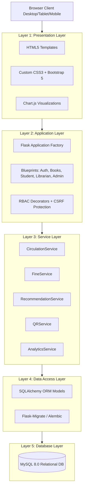
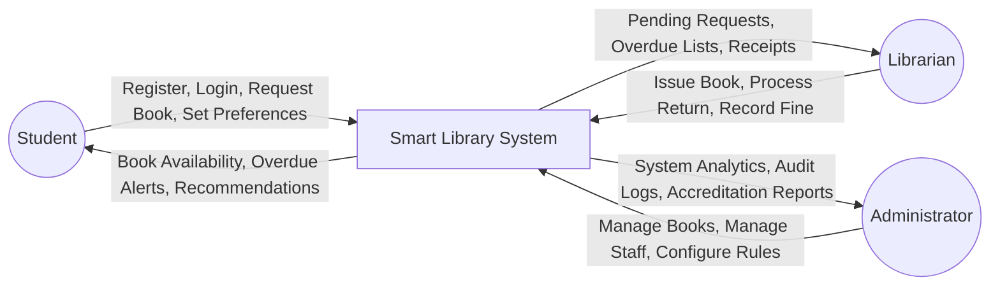
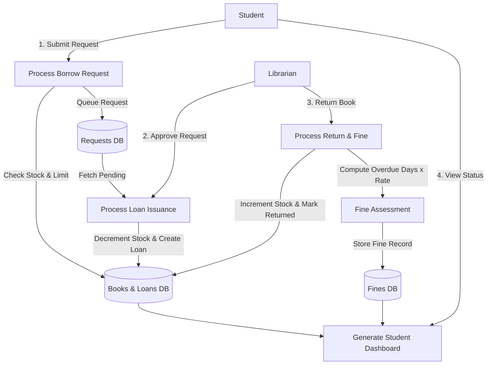
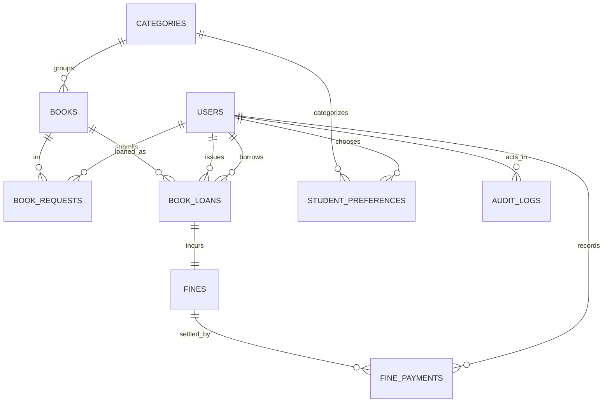

# COLLEGE MINOR PROJECT REPORT
# SMART LIBRARY MANAGEMENT SYSTEM

---

## PROJECT METADATA
* **Project Title:** Smart Library Management System
* **Author / Developer:** Atul Namdeo (GitHub: [@atulnamdeo61-a11y](https://github.com/atulnamdeo61-a11y))
* **Email:** atulnamdeo61@gmail.com
* **Project Nature:** Personal Minor Academic Project
* **Licensing:** Proprietary & Confidential (All Rights Reserved — Strictly Non-Open-Source)
* **Domain:** Web Application / Information Systems / Database Engineering
* **Technology Stack:** Python 3, Flask, SQLAlchemy ORM, MySQL 8.0 / SQLite, Bootstrap 5, Chart.js, QR Code
* **Target Environment:** College Computer Science & Information Technology Department

---

## 1. ABSTRACT
The **Smart Library Management System** is a full-stack web application developed to modernize and automate the day-to-day operations of an academic library. Conventional manual library systems suffer from inefficiencies such as misplaced stock, manual registers, delayed overdue detection, and lack of book discoverability. This project introduces a 5-layer modular system offering role-based access control for Administrators, Librarians, and Students. Key innovations include automatic QR code generation for physical volume identification, an explainable content-based recommendation engine leveraging reading history and student interests, real-time Chart.js administrative analytics, and an automated Indian Rupee fine accrual mechanism with date-only precision. The system maintains strict stock consistency through atomic database transactions and adheres to RESTful architecture and secure coding practices.

---

## 2. INTRODUCTION & PROBLEM STATEMENT

### 2.1 Introduction
Academic libraries serve as the intellectual cornerstone of higher education institutions. Managing thousands of catalog titles, student borrowings, returns, and inventory counts requires high reliability and data integrity. Modern institutions require a digital platform accessible across desktops, tablets, and smartphones that simplifies book discovery for students while providing robust administrative controls for library staff.

### 2.2 Problem Statement
In traditional manual or primitive desktop-based library setups:
1. **Manual Recordkeeping:** Borrowings and returns are logged in physical registers, leading to human error, illegible entries, and lost history.
2. **Delayed Overdue Penalties:** Librarians must manually inspect cards to determine overdue books and calculate penalties.
3. **Inventory Discrepancy:** The number of physical copies on shelves frequently falls out of sync with paper logs.
4. **Poor Discoverability:** Students struggle to locate relevant reference books or identify related volumes in their syllabus.
5. **Lack of Auditability:** There is no centralized tracking of which staff member issued, approved, or waived fines on books.

---

## 3. OBJECTIVES & PROPOSED SYSTEM

### 3.1 Project Objectives
1. Digitize catalog management with multi-field search (Title, Author, ISBN, Category).
2. Automate the end-to-end circulation lifecycle: Request $\to$ Staff Approval $\to$ Issue $\to$ Return.
3. Enforce borrowing policies: configurable 14-day loan cycles and a maximum limit of 3 books per student.
4. Calculate overdue fines automatically at a configurable rate (default ₹2.00/day) with receipt recording and waiver capabilities.
5. Provide individual QR codes for each physical title for rapid shelf lookups and printable tags.
6. Deliver personalized book recommendations based on user interests and historical borrowing.
7. Present real-time dashboard analytics using Chart.js based on actual database records.

### 3.2 Comparison: Existing System vs. Proposed System

| Parameter | Existing Manual System | Proposed Smart Library System |
| :--- | :--- | :--- |
| **Catalog Search** | Physical card catalog or manual scanning | Instant multi-field case-insensitive search & filtering |
| **Loan Recording** | Handwritten paper register | Atomic database transaction with timestamps |
| **Overdue Tracking** | Manual date calculation | Automated real-time overdue alerts with daily fine calculations |
| **Stock Tracking** | Prone to discrepancy | Atomic inventory decrement/increment |
| **Discovery** | Word-of-mouth | Smart personalized recommendation engine |
| **Shelf Identification**| Paper tags | High-resolution scannable QR codes |
| **Analytics** | Manual tallying | Real-time Chart.js graphs and printable reports |

---

## 4. SYSTEM REQUIREMENTS

### 4.1 Functional Requirements
* **FR-1 Authentication:** Secure login, registration for students, password hashing via Werkzeug, session management via Flask-Login.
* **FR-2 Role-Based Authorization:** Strict backend route enforcement for Admin, Librarian, and Student roles.
* **FR-3 Book Management:** Add, edit, soft-delete books, manage categories, track physical and available copies.
* **FR-4 Circulation Management:** Request books, approve/reject requests, issue books directly, process returns.
* **FR-5 Fine Management:** Calculate overdue fines using date-only math; record counter payments; support admin fine waivers.
* **FR-6 Smart Features:** QR code shelf tags, recommendation engine, in-app overdue notices, dynamic dashboard analytics.
* **FR-7 Audit Trail:** Log security events, logins, loans, returns, and payment records.

### 4.2 Non-Functional Requirements
* **NFR-1 Security:** CSRF protection on state-changing forms, parameter binding to prevent SQL injection, protection against unauthorized access.
* **NFR-2 Data Consistency:** ACID transaction compliance; preventing duplicate returns and over-issuing.
* **NFR-3 Usability & Responsiveness:** Intuitive Bootstrap 5 user interface responsive across mobile, tablet, and desktop screens.
* **NFR-4 Performance:** Sub-second query execution using database indexing on search columns.

### 4.3 Hardware & Software Specifications
* **Operating System:** Windows 10/11, Linux, or macOS
* **Runtime:** Python 3.8+ / Python 3.14
* **Backend Framework:** Flask 3.0.3, Flask-SQLAlchemy 3.1.1, Flask-Login, Flask-WTF
* **Database:** MySQL 8.0 / SQLite (for testing & isolated execution)
* **Frontend:** HTML5, CSS3, JavaScript (ES6), Bootstrap 5.3.3, Bootstrap Icons, Chart.js

---

## 5. SYSTEM ARCHITECTURE & DATA FLOW

### 5.1 System Architecture Diagram
The application follows a 5-layer modular architecture: Presentation, Application, Service, Data Access, and Database.

### 5.2 Context Data Flow Diagram (Level 0 DFD)

### 5.3 Level 1 Data Flow Diagram (Circulation & Fines)

---

## 6. DATABASE DESIGN & ENTITY-RELATIONSHIP MODEL

The system uses 9 normalized relational tables:
1. `users`: Stores administrators, librarians, and students with roles and hashed credentials.
2. `categories`: Academic topics and departments.
3. `books`: Title, author, ISBN, shelf location, total copies, available copies, and QR code path.
4. `book_requests`: Student borrow requests awaiting staff review.
5. `book_loans`: Active and historical circulation loans with due dates and return dates.
6. `fines`: Fine assessments with calculated amount, amount paid, and status.
7. `fine_payments`: Audit receipts of payments received.
8. `student_preferences`: Category reading interests.
9. `audit_logs`: Immutable security action log.

---

## 7. CORE ALGORITHMS & IMPLEMENTATION LOGIC

### 7.1 Explainable Recommendation Engine
The system implements a transparent, content-based recommendation algorithm directly on the relational database:
$$\text{Score}(B) = 5.0 \cdot \mathbb{I}_{[\text{Category}(B) \in \text{Preferences}]} + 2.5 \cdot \text{Freq}(\text{Category}(B), \text{History}) - 3.0 \cdot \mathbb{I}_{[B \in \text{History}]} + \min(0.5 \cdot \text{Loans}(B), 3.0)$$
* Available books are scored and sorted descending.
* Each recommendation provides a human-readable reason chip (e.g., *"Matches your chosen interest in Computer Science"* or *"Because you frequently read books in this topic"*).
* If the student is new, it falls back to overall college borrow popularity.

### 7.2 Overdue Fine Calculation Algorithm
* **Cutoff Date:**
  $$\text{Cutoff} = \begin{cases} \text{return\_date} & \text{if returned} \\ \text{today()} & \text{if active} \end{cases}$$
* **Overdue Days:**
  $$\text{Overdue Days} = \max(0, \text{Cutoff} - \text{due\_date})$$
* **Billable Days:**
  $$\text{Billable Days} = \max(0, \text{Overdue Days} - \text{grace\_period})$$
* **Calculated Fine Amount:**
  $$\text{Fine} = \text{Billable Days} \times \text{fine\_rate\_snapshot}$$
* Preserves historical fine rates snapshot on the loan record. Charges zero fine prior to due date and halts accrual once returned.

---

## 8. AUTOMATED TESTING & VERIFICATION RESULTS

The system was verified using automated tests written with `pytest` using an isolated in-memory test database. All 26 test cases passed successfully.

| Test Module | Tests Executed | Passed | Failed | Status |
| :--- | :---: | :---: | :---: | :---: |
| **`test_auth.py`** (Registration, Login, Hashing, Role Tampering Prevention) | 5 | 5 | 0 | PASSED |
| **`test_authorization.py`** (RBAC Protection, Student Isolation, Admin Access) | 5 | 5 | 0 | PASSED |
| **`test_books.py`** (Book CRUD, Invalid Copies Validation, Search, QR Generation) | 5 | 5 | 0 | PASSED |
| **`test_circulation.py`** (Requests, Stock Atomicity, Double Return Prevention) | 5 | 5 | 0 | PASSED |
| **`test_fines.py`** (Overdue Calculations, Return Freezing, Payment Limits) | 4 | 4 | 0 | PASSED |
| **`test_recommendations.py`** (Category Preference Tuning, Popular Fallbacks) | 2 | 2 | 0 | PASSED |
| **TOTAL** | **26** | **26** | **0** | **100% PASSED** |

---

## 9. LIMITATIONS & FUTURE ENHANCEMENTS

### 9.1 Known Limitations
1. In-app payment recording simulates counter transactions; a live payment gateway (Razorpay / Stripe) is not integrated in this academic demo.
2. QR codes point to application web URLs; integration with specialized optical hardware scanners requires USB HID keyboard wedge emulation.

### 9.2 Future Enhancements
1. **Email / SMS Reminders:** Integration of background SMTP/Twilio workers for automated due date notices 2 days prior to expiration.
2. **RFID Tagging:** RFID antenna readers at library exit gates for anti-theft detection.
3. **E-Book PDF Viewer:** Built-in PDF reader for licensed digital university dissertations.

---

## 10. CONCLUSION
The **Smart Library Management System** successfully fulfills all requirements for a college computer science/IT minor project. By decoupling the architecture into five cohesive layers, utilizing SQLAlchemy ORM for data integrity, providing scannable QR codes, automated Indian Rupee fine accounting, and an explainable recommendation engine, the project provides a comprehensive, production-grade demonstration for evaluators and viva examinations.

---

## 11. REFERENCES
1. Flask Documentation: https://flask.palletsprojects.com/
2. SQLAlchemy 2.0 ORM Documentation: https://docs.sqlalchemy.org/
3. Bootstrap 5 Component Guide: https://getbootstrap.com/
4. Chart.js Documentation: https://www.chartjs.org/
5. Python `qrcode` Library: https://github.com/lincolnloop/python-qrcode
