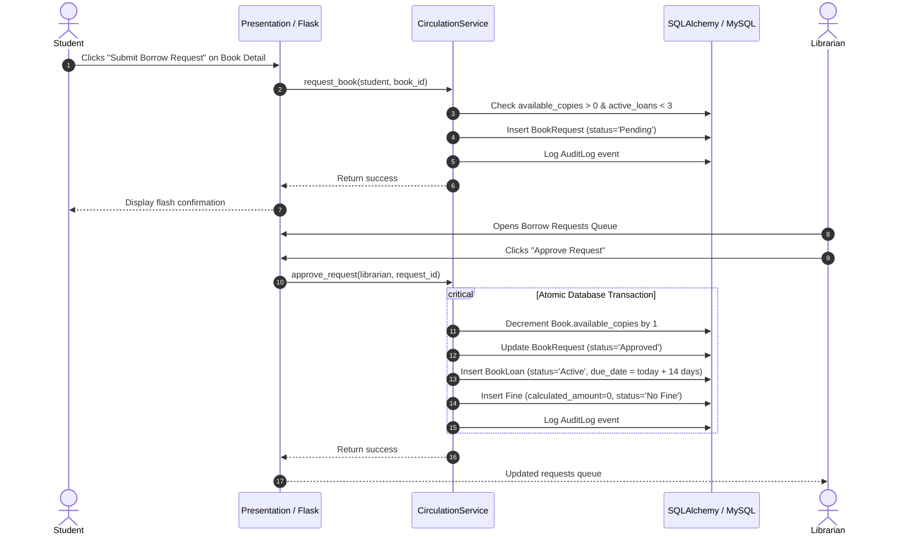
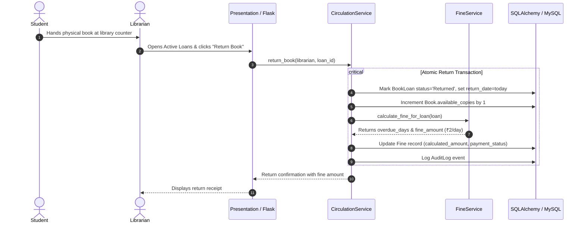

# System Architecture & Design Specification

## 1. Architecture Overview

The **Smart Library Management System** is designed using a 5-layer modular architecture following enterprise software engineering standards. The design enforces clear separation of concerns, decoupling presentation, HTTP routing, business logic, ORM data mapping, and relational database persistence.

```mermaid
graph TD
    subgraph Presentation_Layer [Layer 1: Presentation Layer]
        UI[HTML5 + Custom CSS3 Design System]
        BS[Bootstrap 5 + Bootstrap Icons]
        JS[JavaScript Client Utilities]
        CH[Chart.js Visualizations]
        JT[Jinja2 Dynamic Template Engine]
    end

    subgraph Application_Layer [Layer 2: Application Layer]
        FL[Flask Application Factory - create_app]
        AUTH_BP[Auth Blueprint - /auth]
        BOOKS_BP[Books Blueprint - /books]
        STUDENT_BP[Student Blueprint - /student]
        LIBRARIAN_BP[Librarian Blueprint - /librarian]
        ADMIN_BP[Admin Blueprint - /admin]
        RBAC[Role-Based Access Control @role_required]
        WTF[Flask-WTF & CSRF Token Validation]
    end

    subgraph Service_Layer [Layer 3: Service Layer]
        CIRC[CirculationService - Requests, Loans, Returns, Limit Checks]
        FINE[FineService - Date-Only Overdue Calculation, Payments, Waivers]
        RECOM[RecommendationService - Preferences, History, Fallback]
        QR[QRService - QR Code Matrix Generation & Shelf Labels]
        ANALYTICS[AnalyticsService - Aggregated KPIs & Chart Data]
    end

    subgraph Data_Access_Layer [Layer 4: Data Access Layer]
        ORM[Flask-SQLAlchemy ORM 3.1]
        MODELS[Models: User, Book, Category, BookRequest, BookLoan, Fine, FinePayment, StudentPreference, AuditLog]
        MIGRATE[Flask-Migrate / Alembic Schema Management]
    end

    subgraph Database_Layer [Layer 5: Database Persistence Layer]
        DB[(MySQL 8.0 / Relational DB)]
    end

    Presentation_Layer --> Application_Layer
    Application_Layer --> Service_Layer
    Service_Layer --> Data_Access_Layer
    Data_Access_Layer --> Database_Layer
```

---

## 2. Detailed Layer Descriptions

### Layer 1: Presentation Layer
* **Templates (`app/templates/`)**: Structured using Jinja2 layout inheritance from `base.html`.
* **Design System (`app/static/css/style.css`)**: Implements CSS variables, glassmorphic top navigation, elevated metric cards, responsive tables, badge systems, and micro-animations.
* **Client Scripts (`app/static/js/main.js`)**: Auto-dismissing alerts, Bootstrap popovers/tooltips, modal confirmations for state-changing operations.
* **Data Visualization**: Real-time Chart.js doughnut, line, and bar graphs rendered from actual database metrics.

### Layer 2: Application Layer
* **Application Factory (`app/__init__.py`)**: Implements `create_app(config_name)` supporting development, testing, and production configurations.
* **Modular Blueprints**:
  * `auth`: Student registration, credential validation, session handling, secure role-based landings.
  * `books`: Public catalog, multi-criteria filtering, search, book detail views, QR label printing.
  * `student`: Student self-service dashboard, active loans countdown, return history, reading interests, fine statements.
  * `librarian`: Counter circulation desk, borrow request approval queue, direct issuing, book return intake, fine payments.
  * `admin`: Executive management, books CRUD with safe soft-deletion, categories, user staff accounts, reports, settings, and audit logs.
* **Security Middleware (`app/auth/decorators.py`)**: Decorators (`@admin_required`, `@staff_required`, `@student_required`) enforcing backend access control independent of UI buttons.

### Layer 3: Service Layer
* **`CirculationService`**: Enforces business limits (3 active loans per student, copy stock limits, atomic decrement/increment, duplicate request prevention).
* **`FineService`**: Implements date-only penalty calculations (default ₹2.00/day, grace period 0), payment receipt recording, and administrative waiver management.
* **`RecommendationService`**: Explainable content-based recommendation algorithm leveraging explicit student category preferences, historical loans frequency, and college popularity.
* **`QRService`**: Generates high-resolution PNG QR codes mapping physical volumes directly to `/books/<book_id>` catalog URLs.
* **`AnalyticsService`**: Formats structured dataset metrics for admin and librarian dashboards.

### Layer 4: Data Access Layer
* **SQLAlchemy ORM (`app/models/`)**: Strongly typed models defining table structures, primary keys, foreign key constraints, cascaded deletions, indexes, and relationship proxies.
* **Atomic Transactions**: All multi-table updates (e.g. loan approval + inventory decrement + fine initialization) run within atomic `db.session` transactions with automatic rollback on error.

### Layer 5: Database Layer
* **MySQL 8.0**: Relational database with InnoDB engine supporting foreign key constraints, ACID compliance, transactions, and UTF-8 encoding.
* **Database Migrations**: Managed via `Flask-Migrate` (Alembic) to track schema evolutions over time.

---

## 3. Key Operational Workflows

### 3.1 Book Borrowing Workflow

### 3.2 Book Return & Overdue Fine Workflow

