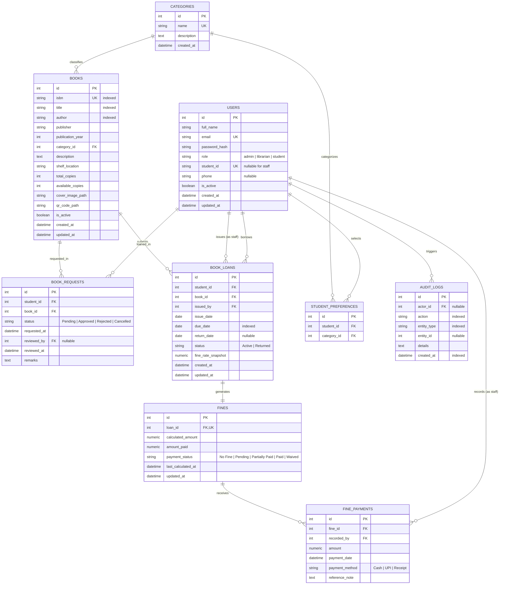

# Database Design & Schema Specification

## 1. Entity-Relationship (ER) Diagram

---

## 2. Table Schemas & Constraints

### 2.1 Table: `users`
Represents all system actors distinguished by the `role` attribute.
* `id`: Integer, Primary Key, Auto Increment.
* `full_name`: VARCHAR(120), NOT NULL.
* `email`: VARCHAR(120), UNIQUE, NOT NULL, INDEXED.
* `password_hash`: VARCHAR(255), NOT NULL.
* `role`: VARCHAR(20), NOT NULL, DEFAULT `'student'`, INDEXED.
* `student_id`: VARCHAR(50), UNIQUE, NULLABLE (mandatory for students), INDEXED.
* `phone`: VARCHAR(20), NULLABLE.
* `is_active`: BOOLEAN, NOT NULL, DEFAULT TRUE.
* `created_at`: DATETIME, NOT NULL, DEFAULT UTC.
* `updated_at`: DATETIME, NOT NULL, DEFAULT UTC ON UPDATE.

### 2.2 Table: `categories`
Organizes books into departments and areas of study.
* `id`: Integer, Primary Key.
* `name`: VARCHAR(100), UNIQUE, NOT NULL, INDEXED.
* `description`: TEXT, NULLABLE.
* `created_at`: DATETIME, NOT NULL, DEFAULT UTC.

### 2.3 Table: `books`
Main physical library inventory catalog.
* `id`: Integer, Primary Key.
* `isbn`: VARCHAR(30), UNIQUE, NULLABLE, INDEXED.
* `title`: VARCHAR(255), NOT NULL, INDEXED.
* `author`: VARCHAR(255), NOT NULL, INDEXED.
* `publisher`: VARCHAR(255), NULLABLE.
* `publication_year`: INTEGER, NULLABLE.
* `category_id`: INTEGER, FOREIGN KEY (`categories.id`), NOT NULL, INDEXED.
* `description`: TEXT, NULLABLE.
* `shelf_location`: VARCHAR(50), NULLABLE (e.g. `'CS-Rack-01'`).
* `total_copies`: INTEGER, NOT NULL, DEFAULT 1.
* `available_copies`: INTEGER, NOT NULL, DEFAULT 1.
* `cover_image_path`: VARCHAR(255), NULLABLE.
* `qr_code_path`: VARCHAR(255), NULLABLE.
* `is_active`: BOOLEAN, NOT NULL, DEFAULT TRUE.
* `created_at`: DATETIME, NOT NULL.
* `updated_at`: DATETIME, NOT NULL.

### 2.4 Table: `book_requests`
Stores borrow requests submitted by students.
* `id`: Integer, Primary Key.
* `student_id`: INTEGER, FOREIGN KEY (`users.id`), NOT NULL, INDEXED.
* `book_id`: INTEGER, FOREIGN KEY (`books.id`), NOT NULL, INDEXED.
* `status`: VARCHAR(20), NOT NULL, DEFAULT `'Pending'` (`Pending`, `Approved`, `Rejected`, `Cancelled`), INDEXED.
* `requested_at`: DATETIME, NOT NULL.
* `reviewed_by`: INTEGER, FOREIGN KEY (`users.id`), NULLABLE.
* `reviewed_at`: DATETIME, NULLABLE.
* `remarks`: TEXT, NULLABLE.

### 2.5 Table: `book_loans`
Tracks physical book circulation, due dates, and return history.
* `id`: Integer, Primary Key.
* `student_id`: INTEGER, FOREIGN KEY (`users.id`), NOT NULL, INDEXED.
* `book_id`: INTEGER, FOREIGN KEY (`books.id`), NOT NULL, INDEXED.
* `issued_by`: INTEGER, FOREIGN KEY (`users.id`), NOT NULL.
* `issue_date`: DATE, NOT NULL.
* `due_date`: DATE, NOT NULL, INDEXED.
* `return_date`: DATE, NULLABLE.
* `status`: VARCHAR(20), NOT NULL, DEFAULT `'Active'` (`Active`, `Returned`), INDEXED.
* `fine_rate_snapshot`: NUMERIC(8, 2), NOT NULL, DEFAULT 2.00.
* `created_at`: DATETIME, NOT NULL.
* `updated_at`: DATETIME, NOT NULL.

### 2.6 Table: `fines`
Financial penalties assessed on overdue loans.
* `id`: Integer, Primary Key.
* `loan_id`: INTEGER, FOREIGN KEY (`book_loans.id`), UNIQUE, NOT NULL, INDEXED.
* `calculated_amount`: NUMERIC(8, 2), NOT NULL, DEFAULT 0.00.
* `amount_paid`: NUMERIC(8, 2), NOT NULL, DEFAULT 0.00.
* `payment_status`: VARCHAR(20), NOT NULL, DEFAULT `'No Fine'`, INDEXED (`No Fine`, `Pending`, `Partially Paid`, `Paid`, `Waived`).
* `last_calculated_at`: DATETIME, NOT NULL.
* `updated_at`: DATETIME, NOT NULL.

### 2.7 Table: `fine_payments`
Audit records of payments received against fines.
* `id`: Integer, Primary Key.
* `fine_id`: INTEGER, FOREIGN KEY (`fines.id`), NOT NULL, INDEXED.
* `recorded_by`: INTEGER, FOREIGN KEY (`users.id`), NOT NULL.
* `amount`: NUMERIC(8, 2), NOT NULL.
* `payment_date`: DATETIME, NOT NULL.
* `payment_method`: VARCHAR(50), NOT NULL, DEFAULT `'Cash'`.
* `reference_note`: TEXT, NULLABLE.

### 2.8 Table: `student_preferences`
Maps student interest in academic categories for personalized recommendations.
* `id`: Integer, Primary Key.
* `student_id`: INTEGER, FOREIGN KEY (`users.id`), NOT NULL, INDEXED.
* `category_id`: INTEGER, FOREIGN KEY (`categories.id`), NOT NULL, INDEXED.
* **Unique Constraint**: `uq_student_category_pref` (`student_id`, `category_id`) preventing duplicates.

### 2.9 Table: `audit_logs`
System security and administrative action audit trail.
* `id`: Integer, Primary Key.
* `actor_id`: INTEGER, FOREIGN KEY (`users.id`), NULLABLE, INDEXED.
* `action`: VARCHAR(100), NOT NULL, INDEXED.
* `entity_type`: VARCHAR(50), NOT NULL, INDEXED.
* `entity_id`: INTEGER, NULLABLE.
* `details`: TEXT, NULLABLE.
* `created_at`: DATETIME, NOT NULL, INDEXED.

---

## 3. Stock Consistency & Concurrency Protection

1. **Available Copies Validation**:
   * Total copies must be $\ge 1$.
   * Available copies must satisfy $0 \le \text{available\_copies} \le \text{total\_copies}$.
2. **Atomic Invariant Operations**:
   * Approving a borrow request:
     $$\text{available\_copies} \leftarrow \text{available\_copies} - 1$$
     Executed strictly within a transaction. If $\text{available\_copies} \le 0$, the transaction rolls back with a user-friendly error.
   * Processing a return:
     $$\text{available\_copies} \leftarrow \min(\text{total\_copies}, \text{available\_copies} + 1)$$
     Guaranteed to execute exactly once; duplicate return submissions are rejected.
3. **Preservation of Historical Integrity**:
   * Deleting a book with active loans is strictly blocked.
   * Deleting a book with past returned loans triggers soft-deletion (`is_active = False`), preserving borrowing records and financial audit trails.
